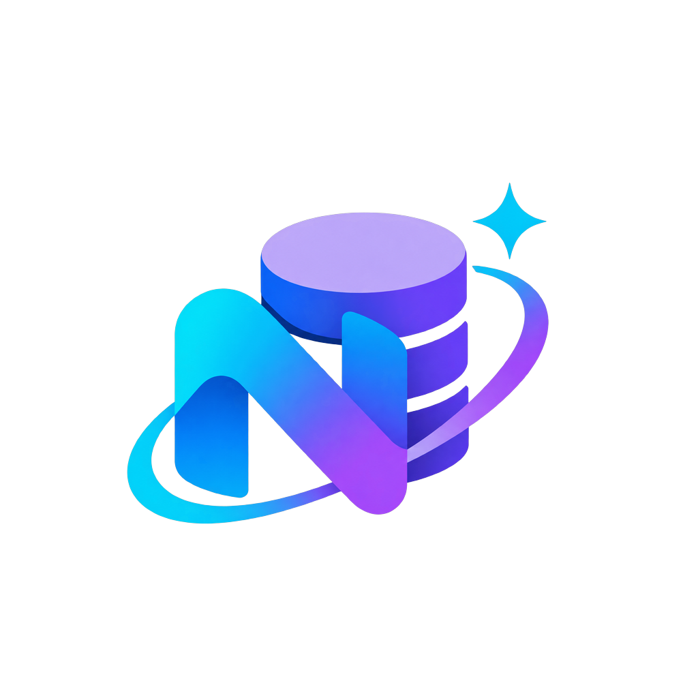

# Nexabase

<p align="center">
  
</p>

<p align="center">
  <strong>Modern, Fast & Cross-Platform Database Studio</strong>
</p>

<p align="center">
  A lightweight, intuitive, and modern database management GUI designed to explore, design, query, and visualize databases including <strong>PostgreSQL</strong>, <strong>MySQL</strong>, <strong>MariaDB</strong>, and <strong>SQLite</strong>. Built with <strong>React</strong>, <strong>TypeScript</strong>, and <strong>Vite</strong>, featuring native desktop support via <strong>Tauri</strong> and <strong>Electron</strong>.
</p>

---

## ✨ Features

- **Multi-Engine Support**: Seamlessly connect to popular databases, including PostgreSQL, MySQL, MariaDB, and SQLite (local or WebAssembly).
- **Interactive Data Grid**: Powerful grid view with pagination, inline cell editing, mutation tracking, real-time sorting, and advanced column filtering.
- **SQL Query Editor & Visual Builder**: Full-featured SQL editor with syntax highlighting, query snippet manager, and an interactive drag-and-drop Visual Query Builder.
- **Object Explorer & Schema Inspector**: Structured tree navigation for schemas, tables, columns, views, stored procedures, triggers, foreign keys, and indexes.
- **Visual Table Designer**: Interactively create and modify table structures, column data types, default values, primary keys, and foreign key constraints.
- **Interactive ER Diagram**: Automatically generate and visualize Entity-Relationship Diagrams with intuitive relation mapping.
- **Data Charts & Visualizer**: Transform query results directly into interactive charts (bar, line, pie) inside the studio.
- **Mock Data Generator**: Generate realistic test data with customizable rules and row counts for database testing.
- **Backup, Restore, Export & Import**: Dump and restore database schemas, or export/import datasets in SQL, CSV, and JSON formats.
- **Server Monitor & User Management**: Monitor database server status, active connections, and configure database users, roles, and privileges.
- **Cross-Platform**: Run in your browser or as a native desktop application on macOS, Windows, and Linux via Tauri or Electron.

---

## 📋 Prerequisites

Before installing and running Nexabase, ensure you have:

- **Node.js**: `v18.x` or higher (LTS `v20+` or `v22+` recommended)
- **Package Manager**: `npm`, `pnpm`, or `yarn`
- **Rust & Cargo** *(Optional)*: Required only if you plan to run or build the desktop version with **Tauri** ([Tauri Setup Guide](https://v2.tauri.app/start/prerequisites/)).

---

## 📦 Installation

1. **Clone the Repository**:
   ```bash
   git clone https://github.com/ianoit/nexabase.git
   cd nexabase
   ```

2. **Install Dependencies**:
   ```bash
   npm install
   ```

---

## 🚀 Running the Application

Nexabase supports multiple runtime environments based on your workflow:

### 1. Web Mode (Browser)
Fastest mode for frontend development and quick testing:
```bash
npm run dev
```
Once the dev server starts, open your browser at:
```text
http://localhost:5173
```
> **Note:** In Web development mode, Vite provides a local middleware proxy to handle remote connections and queries for PostgreSQL and MySQL.

---

### 2. Desktop Mode with Tauri (Recommended)
Tauri provides native desktop performance with minimal memory usage:
```bash
npm run tauri:dev
```

---

### 3. Desktop Mode with Electron
Alternative cross-platform desktop runtime:
```bash
npm run electron:dev
```

---

## 🛠️ Production Build

### Build Web Distribution
Compiles TypeScript and generates optimized static assets in the `dist/` directory:
```bash
npm run build
```

### Build Desktop Installer (Tauri)
Creates platform-specific native installers (`.dmg` for macOS, `.msi` / `.exe` for Windows, `.deb` / `.AppImage` for Linux):
```bash
npm run tauri:build
```

### Build Desktop App (Electron)
Packages the application using `electron-builder`:
```bash
npm run electron:build
```

---

## 📁 Project Structure

```text
nexabase/
├── src/                    # Frontend source code (React + TypeScript)
│   ├── assets/             # Logos, icons, and image assets
│   ├── components/         # UI components (DataGrid, QueryEditor, ERDiagram, etc.)
│   ├── server/             # Database bridge server (PostgreSQL & MySQL handlers)
│   ├── services/           # Database engine gateway & connection services
│   ├── types/              # TypeScript interfaces and schema definitions
│   ├── App.tsx             # Main application layout and view controller
│   └── main.tsx            # React application entry point
├── src-tauri/              # Native Tauri desktop backend (Rust)
│   ├── icons/              # Desktop application icons
│   ├── src/                # Rust backend implementation (native DB connections, windowing)
│   └── tauri.conf.json     # Tauri v2 configuration
├── electron/               # Electron main process and preload scripts
├── public/                 # Static public assets (icons & SQLite WASM)
├── package.json            # Project dependencies and npm scripts
└── vite.config.ts          # Vite configuration & database API middleware plugin
```

---

## 🔧 Additional Scripts

- **Code Linting**:
  ```bash
  npm run lint
  ```
- **Preview Production Build**:
  ```bash
  npm run preview
  ```

---

## 📄 License

This project is independently developed for modern, flexible, and developer-friendly database management.
